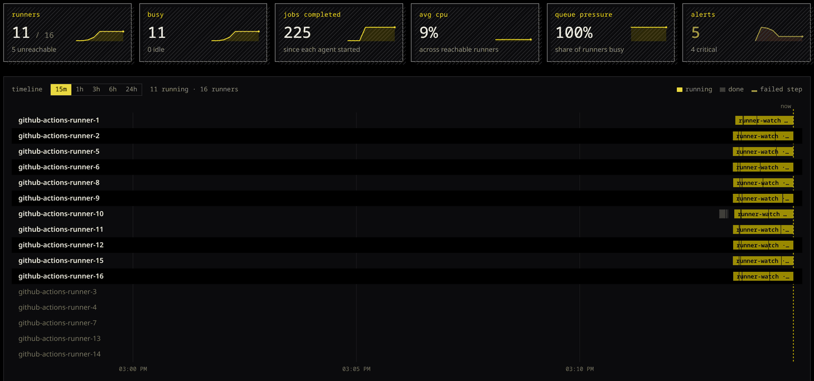

# runner-watch

Every self-hosted GitHub Actions runner on one page. An agent on each
runner reads yeet's system graph once a second and streams a frame; a
hub proxies the agents and serves the dashboard. Nothing runs inside
the job, and the runner software is untouched apart from an optional
job hook that supplies step names and run links.



## Install

### On each runner machine

```sh
curl -fsSL https://yeet.cx | sh
yeet login
yeet service apply -f https://github.com/yeet-src/runner-watch
```

Optional, for step names and run links on the dashboard. The job hook
needs a checkout on the runner, and the runner only reads its `.env`
at startup, so the last line restarts it while idle:

```sh
git clone https://github.com/yeet-src/runner-watch.git ~/runner-watch
~/runner-watch/scripts/install-hooks.sh --restart
```

### On the hub machine

Any host that can reach the runners, usually over Tailscale:

```sh
curl -fsSL https://yeet.cx | sh
yeet login
git clone https://github.com/yeet-src/runner-watch.git && cd runner-watch
make hub PREFIX=github-actions-runner-
```

Open http://localhost:9430/.

### Checking it

```sh
curl -fsS localhost:9420/llms.txt            # on a runner: one snapshot, as text
yeet dial ws://127.0.0.1:9420/tty            # on a runner: the frames; ctrl-c to leave
curl -fsS localhost:9430/llms.txt            # on the hub: the fleet index
yeet service remove -f runner-watch          # stop and remove the agent
```

## How it fits together

- `yeet service apply` clones this repository and creates the agent
  from `service.toml`: three isolates and a web server on `:9420`.
  Rerun the same line to move to a newer commit; a service you stopped
  stays stopped.
- `make hub` runs `install-hub.sh`: it finds every tailnet host whose
  name starts with the prefix, writes `hub.toml` with one upstream
  route per runner, and applies it. The hub subscribes to each runner's
  route manifest, so a runner appears as soon as its agent answers.
- To change the roster, rerun `make hub`, or edit `hub.toml` and
  `yeet service apply -f hub.toml`. To add one runner without a
  rewrite: `yeet service mount runner-watch-hub/web -L /r/<name> -U http://<name>:9420/`.
- The dashboard names each runner by its hub route, `/r/<name>/`. The
  agent's `/metrics` and `/llms.txt` use `--name` from `service.toml`,
  or the `RUNNER_NAME` the job hook reports with the first job.

### The whole fleet over ssh

From the hub host, `scripts/deploy.sh` does everything above, hook
included:

```sh
scripts/deploy.sh --all --prefix github-actions-runner- --restart-runner
```

It finds hosts by prefix through tailscale, copies the tree to
`~/runner-watch` on each, applies the agent, wires the hook, restarts
idle runners, then installs the hub here. Deploy as the runner's own
user (`SSH_USER=runner`, or `user@host` in place of `--all`) so it can
read the hooks; set `SUDO=sudo` if the yeet socket needs it.

Two workflows do the same without a laptop in the loop:
`deploy-runners.yml` (manual) runs one job per runner, on that runner,
and applies `service.toml` to it; `deploy-hub.yml` redeploys the hub
over ssh on every push to `main` (secret `HUB_SSH_KEY`, variable
`HUB_HOST`).

| script | what |
|---|---|
| `scripts/deploy.sh HOST… \| --all [--prefix P] [--restart-runner] [--no-hub]` | runners and hub over ssh (`SSH_USER`, `SSH_OPTS`, `SUDO`, `PORT`) |
| `scripts/install-agent.sh [--name N] [--port P]` | apply `service.toml` here with a name and port |
| `scripts/install-hooks.sh [--root DIR] [--restart]` | wire the job hook into the runner's `.env` here |
| `scripts/install-hub.sh [--port P] [--prefix P] [--runner NAME=HOST…] [--dry-run]` | write and apply `hub.toml` here |
| `scripts/deploy-hub.sh [user@]HOST [install-hub flags]` | install the hub on another host over ssh |
| `scripts/fake-runner.sh [root] [repo]` | a stand-in runner that runs a job every few seconds (`CONTAINER=1` for `docker exec`) |

`make up PORT=9421`, `make hub`, `make down`, `make status` and
`make check` wrap the common ones.

## What it shows


- **Timeline**: one lane per runner, a bar per job, step boundaries
  inside the bar, a red strip under a failed step, 15 minutes to 24
  hours. Bars link to the run on GitHub.
- **Tiles**: reachable, busy, jobs completed, average cpu, share busy,
  runners with alerts, each with a sparkline.
- **Rows**: state, health, cpu and memory, load, the job and its step,
  elapsed, jobs done, busy share. Expanded: links to the repo, run and
  commit; steps with timings and results; a "waiting on" line that
  classifies the step's leaf processes (`running`, `disk`, `network`,
  `connecting`, `sleeping`, `setup`, `zombie`, `stopped`); containers
  and top processes; the previous run's steps; recent jobs; a diagnosis
  of the listener's connection, cpu split, blocked and zombie
  processes, swap, the default interface and dns, the hottest sensor,
  leftovers from a finished job and clock skew.

Health reason codes: `mem_low`, `swapping`, `writeback`, `iowait`,
`steal`, `blocked`, `load`, `zombies`, `thermal`, `no_listener`,
`disconnected`, `fds`, `stall`, `slow_step`, `disk_wait`,
`connect_timeout`, `leftover_containers`, `leftover_procs`,
`no_default_route`, `iface_down`, `no_dns`, `drops`, plus the hub's
`unreachable`, `agent_stalled`, `connecting` and `clock_skew`. A step
is slow past twice its median for that step name and repository.

## Endpoints

On each agent (`:9420`), and through the hub under `/r/<name>/`:

| path | kind | content |
|---|---|---|
| `/tty` | websocket | one OSC 7880 frame per second: `{t:"tick", ts, name, host, runners[], health, stats, history[]}` |
| `/metrics` | per-request | Prometheus exposition, `runner_watch_*`, labelled `runner="<name>"` |
| `/llms.txt` | per-request | markdown snapshot: health, host, network, runners, containers |
| `/.well-known/yeet/manifest.json` | | the route manifest |

On the hub (`:9430`): `/` the dashboard, `/llms.txt` a fleet index,
`/runners.json` the configured names, and the merged manifest.

Notable series: `runner_watch_health_level`,
`runner_watch_health_reason{code}`, `runner_watch_listener_connected`,
`runner_watch_job_wait{kind}`, `runner_watch_job_elapsed_seconds`,
`runner_watch_host_cpu_split_ratio{kind}`, `runner_watch_iface_up`.

## Planned improvements

- Reading the hostname from the daemon, so `/metrics` is labelled
  before the first job runs.
- Disk usage, once the system graph exposes filesystems.
- A fleet-wide `/llms.txt` on the hub, which needs isolates to dial out.
- Active dns and connect probes from the runner.
- History that survives an agent restart.
