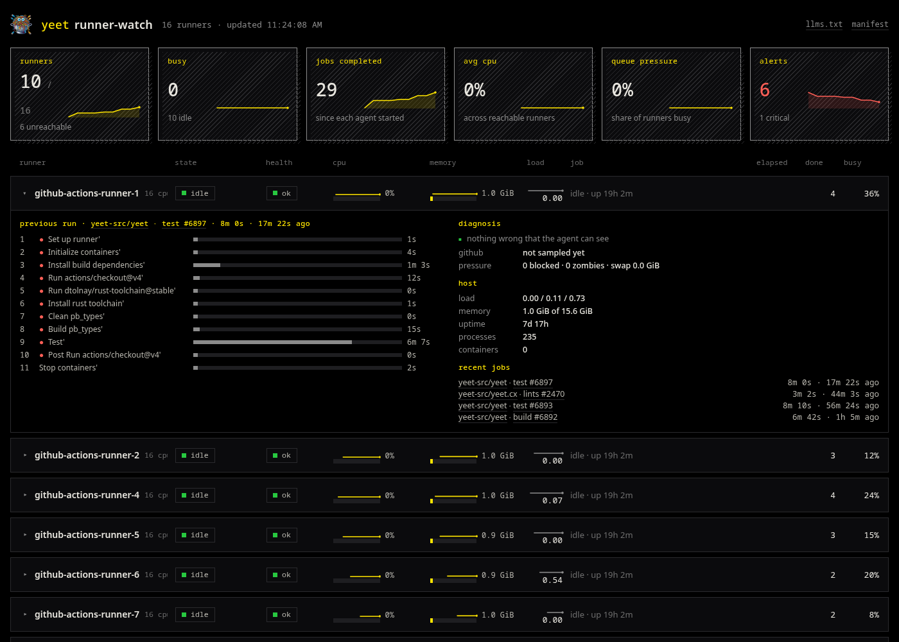

# runner-watch

What every self-hosted GitHub Actions runner is doing, on one page, from
yeet's system graph. An agent on each runner host reads the process
table, cpu, memory, load and docker once a second and streams a frame;
a hub on any host proxies every agent and serves the dashboard.



Each runner also serves `/metrics` for Prometheus and `/llms.txt` for
anything that would rather read text. Nothing runs inside the job, and
the runner software is untouched apart from an optional job hook that
supplies step names and run links.

## Requirements

- Linux hosts with [yeet](https://yeet.cx) installed and logged in, on
  the runners and on the hub.
- The runners reachable from the hub by name, for example over
  tailscale. The install script discovers `github-actions-runner-*`
  peers from `tailscale status`; any resolvable host works with
  `--runner NAME=HOST`.
- SSH access from the hub to the runners for `deploy.sh`; otherwise run
  `install-agent.sh` on each runner by hand.

## Install

From a checkout on the hub host:

```sh
scripts/deploy.sh --all --restart-runner   # agents + job hook on every runner
scripts/install-hub.sh                     # the hub, on this host
```

`--all` means every tailscale peer named `github-actions-runner-*`.
Pass `--prefix my-runner-` to both scripts if yours are named
differently, or name the hosts outright: `scripts/deploy.sh host1 host2`
and `scripts/install-hub.sh --runner name1=host1 --runner name2=host2`.

The dashboard is at `http://<hub>:9430/`. `deploy.sh` copies this
directory to `~/runner-watch` on each runner, installs the agent as a
yeet service on port 9420, wires the job hook into the runner's `.env`
and checks the agent answers from here. It is idempotent; rerun it to
roll out a change. `--restart-runner` restarts an idle runner so the
hook takes effect, since the runner reads `.env` only at startup.

The runner executes the job hook as its own user, which must be able to
read `~/runner-watch/hooks` in the login user's home and the install
needs to write the runner's `.env`. The simplest arrangement is to
deploy as the runner's user, `SSH_USER=runner scripts/deploy.sh --all`;
otherwise `install-hooks.sh` prints a note when the runner's user cannot
read the hooks. Set `SUDO=sudo` if the yeet socket needs it.

To add a runner later, deploy to it and rerun `install-hub.sh`, or
mount the route on the running hub:

```sh
yeet service mount runner-watch-hub/web -L /r/<name> -U http://<name>:9420/
```

| script | what |
|---|---|
| `scripts/deploy.sh HOST… \| --all [--prefix P] [--restart-runner]` | install agent and hook on runners over ssh (`SSH_USER`, `SSH_OPTS`, `SUDO`, `PORT`) |
| `scripts/install-agent.sh [--name N] [--port P] [--dev]` | install the agent service on the current host |
| `scripts/install-hooks.sh [--root DIR] [--restart]` | wire the job hook into the runner's `.env` on the current host |
| `scripts/install-hub.sh [--port P] [--prefix P] [--runner NAME=HOST…] [--dry-run]` | install the hub on the current host |
| `scripts/fake-runner.sh [root] [repo]` | a stand-in `Runner.Listener`/`Runner.Worker` that runs a job every few seconds; `CONTAINER=1` runs the job through `docker exec` |

## What it shows

Tiles for the fleet: reachable, busy, jobs completed, average cpu, share
of runners busy, and runners with alerts, each with a sparkline.

One row per runner, busy first, then by health: state, health, cpu and
memory meters, load, the job with its current step, elapsed, jobs done
and the share of uptime spent busy. The panel under a row shows:

- the current job with links to the repository, run and commit, the
  steps so far with real names, timings and results, a "waiting on" line
  for the current step, containers and top processes;
- the previous run's steps for comparison, and recent jobs;
- a diagnosis: the listener's connection to GitHub, cpu split into user,
  system, iowait and steal, blocked and zombie processes, swap and dirty
  pages, the default interface with dns and throughput, the hottest
  sensor, the listener's file descriptors, leftovers from a finished
  job, and clock skew against the browser;
- host facts.

Health rolls those up with stable reason codes: `mem_low`, `swapping`,
`writeback`, `iowait`, `steal`, `blocked`, `load`, `zombies`,
`thermal`, `no_listener`, `disconnected`, `fds`, `stall`, `slow_step`,
`disk_wait`, `connect_timeout`, `leftover_containers`, `leftover_procs`,
`no_default_route`, `iface_down`, `no_dns`, `drops`, plus the hub's own
`unreachable`, `agent_stalled`, `connecting` and `clock_skew`.

"Waiting on" classifies the current step's leaf processes as `running`,
`disk`, `network`, `connecting`, `sleeping`, `setup`, `zombie` or
`stopped`, from process state, cpu and io deltas and the sockets they
hold. For a `container:` job the leaves are the processes inside the
container, found by cgroup, not the `docker exec` client. A step is
marked slow when it is past twice its median duration for that step
name and repository, learned from the hook's step results.

## Endpoints

On each agent (port 9420), and through the hub under `/r/<name>/`:

| path | kind | content |
|---|---|---|
| `/tty` | websocket | one OSC 7880 frame per second: `{t:"tick", ts, name, host, runners[], health, stats, history[]}` |
| `/metrics` | per-request | Prometheus exposition, `runner_watch_*`, labelled `runner="<name>"` |
| `/llms.txt` | per-request | markdown snapshot: health, host, network, runners, containers |
| `/.well-known/yeet/manifest.json` | | the route manifest |

On the hub (port 9430): `/` the dashboard, `/llms.txt` an index of the
fleet, `/runners.json` the configured names, and the manifest, which
lists every reachable runner's routes.

`/metrics` and `/llms.txt` are per-connection console routes: each GET
spawns an isolate that takes one sample, prints and exits, which ends
the chunked body. Notable series: `runner_watch_health_level`,
`runner_watch_health_reason{code}`, `runner_watch_listener_connected`,
`runner_watch_job_wait{kind}`, `runner_watch_job_elapsed_seconds`,
`runner_watch_host_cpu_split_ratio{kind}`, `runner_watch_iface_up`.

## Layout

| file | role |
|---|---|
| `agent.js` | the agent isolate: one graph query per tick, process-tree matching, hook messages, history, the frame |
| `metrics.js`, `llms.js` | per-request exporters on the agent |
| `hub-llms.js` | the hub's `/llms.txt` |
| `lib/runner.js` | the runner process model: listeners, workers, job processes, containers, repository, step labels |
| `lib/diag.js` | diagnosis: socket join, wait classification, host pressure, interfaces, sensors, health |
| `portal.js` | OSC frame encoding |
| `agent.service.toml` | the agent service; `install-agent.sh` fills in directory, name and port |
| `hooks/` | the job hook: `job-started.sh` and `job-completed.sh` wrap `job-hook.sh` |
| `public/index.html` | the dashboard, no dependencies |
| `scripts/` | install and deploy |

## How it works

A GitHub runner is a `Runner.Listener` process with a `Runner.Worker`
child while it has a job; each step is a child of the worker. The repo
comes from `_work/<repo>/<repo>` (or `/__w/<repo>/<repo>` in a
container) in a process's cwd or command line. A job's containers are
those that mount the runner's `_work` tree or are named by a `docker
exec` in the worker's tree, and their processes are matched by cgroup.

Every tick the agent emits one frame on its tty, which the service
mounts at `/tty`. Every five seconds it takes a slower sample: the tcp
tables, the open fds of the listener, worker and the step's leaf
processes, interfaces and sensors. Joining fds to the tcp table by socket
inode is what tells it whether the listener is long-polling GitHub and
what a step is connected to.

The job hook runs when the runner starts and finishes a job, with the
`GITHUB_*` variables set. It writes one JSON line into the agent's tty
with `yeet dial` and, on start, tails the worker's `_diag/Worker_*.log`
for `Processing step:` and `Step result:` lines so steps carry their
display names. Without the hook, steps are labelled by what they ran.

The hub is a yeet service with a static route and one `http://` upstream
route per runner. The daemon proxies websockets and plain requests, and
the hub's manifest includes the routes of every upstream it can reach.
The dashboard reads `runners.json`, then the manifest, dials each
`/r/<name>/tty`, and aggregates in the page.

## Limits

- Disk usage is not in the graph yet, so it is not shown.
- Isolates have no network access, so the hub's `/llms.txt` indexes the
  runners rather than aggregating them, and there are no active dns or
  connect probes.
- Whether the listener's remote is a GitHub address range is best
  effort; the established socket itself is the signal.
- History, jobs completed and busy ratio start when the agent starts.
- A shared tty hangs up for every peer when any peer sends end-of-input,
  and `yeet dial` sends it when its stdin closes or on SIGTERM. The hook
  writes through a FIFO and kills its dial for that reason.
